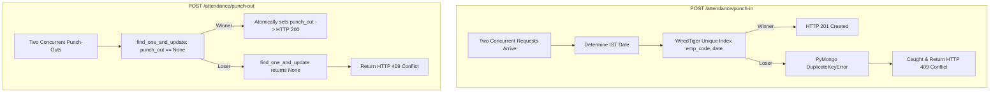

# Interview Walkthrough & Architecture Master Guide
## Employee Attendance & Analytics API (FastAPI + MongoDB)

This document is your preparation manual for the technical interview. It explains every design decision, business rule, database index, concurrency mechanism, and aggregation pipeline stage in plain, confident language so you can walk the interviewer through your code effortlessly.

---

## 1. Executive Summary: What We Built

We designed and implemented a production-grade, high-performance **Employee Attendance & Analytics API** conforming 100% to the OpenAPI specification (`openapi.yaml`), data contract (`DATA_MODEL.md`), and business rules (`R1` through `R10`).

### Core Capabilities:
1. **Attendance Lifecycle**: Race-safe punch-in, atomic punch-out (across midnight for overnight shifts), and paginated attendance browsing.
2. **Audit Trail**: Manual corrections (regularization) via `PATCH /attendance/{emp_code}/{date}` that recomputes derived fields and atomically appends an immutable change log to `history`.
3. **High-Performance Aggregations**:
   - Monthly employee summaries (present days, working days, leave, late minutes, overtime, attendance rate).
   - Cross-collection department summaries (including employees with zero logs).
   - Late-comers leaderboard with competition ranking (`$rank`) and tie-preservation at limit thresholds.
   - 92-day department attendance trend with database-level gap filling (`$densify`) and a 7-day moving average.
4. **Index Optimization**: Backed by compound indexes ensuring index scans (`IXSCAN`) and zero collection scans (`COLLSCAN`), verified via `GET /admin/explain/{endpoint}`.

---

## 2. Core Architecture & Conventions

| Area | Contract / Rule | Implementation Detail |
|---|---|---|
| **Employee ID** | `emp_code` (e.g. `EMP0001`) | Natural business identifier; unique immutable string. Never MongoDB's internal `_id`. |
| **Instants** | Epoch milliseconds integer | API accepts/returns integer milliseconds ($10^{11} \le \text{ms} \le 4.102 \times 10^{12}$). Stored in MongoDB as UTC BSON datetimes. Truncated to whole seconds per R1 before calculations. |
| **Calendar Values** | Strings (`YYYY-MM-DD`, `HH:MM`) | Intentionally strings to avoid timezone shift anomalies across date boundaries. |
| **Derived Fields** | `work_hours`, `late_minutes`, `overtime_minutes`, `half_day` | Computed server-side; read-only for clients. Analytics read stored derived values. |
| **Audit Trail** | `history` array | Records manual regularizations only. Punch-in and punch-out never write to it. |

---

## 3. The 10 Business Rules (R1–R10) Explained Simply

### R1: Time Zone & Attendance Date
- **Time Zone**: Shift times and attendance dates are IST (`UTC+05:30`).
- **Truncation**: Instants are truncated to whole seconds (`.replace(microsecond=0)`) before any calculation.
- **Overnight Shifts (`shift_end <= shift_start`, e.g. 22:00–06:00)**:
  - If a punch-in occurs in the early morning before `shift_end` (e.g. 05:30 IST on July 7), it belongs to the shift that started the previous calendar day (`2026-07-06`).
  - Shift end for an overnight shift falls on the **next** calendar day.

### R2: Late Minutes & Grace Period
- **Grace Period**: Exactly 10 minutes.
- **Rule**: Late only if punch-in is **strictly more than 10:00** after `shift_start` (> 600 seconds).
- **Calculation**: When late, count whole minutes (floor) since `shift_start`, **not** since grace period ended!
- **Examples (Shift 09:30)**:
  - `09:40:00` $\to$ 10 min 0 sec $\to$ not strictly more $\to$ **0 minutes**.
  - `09:40:01` $\to$ 10 min 1 sec $\to$ strictly more $\to$ floor(601s / 60) = **10 minutes**.
  - `10:15:59` $\to$ 45 min 59 sec $\to$ floor(2759s / 60) = **45 minutes**.

### R3: Overtime
- **Rule**: Whole minutes (floor) from `shift_end` to `punch_out`, counted **only if $\ge 30$ minutes**; otherwise 0.
- **Examples (Shift End 18:30)**:
  - Punch-out at `18:59:59` (29 min 59 sec) $\to$ **0 minutes**.
  - Punch-out at `19:00:00` (30 min) $\to$ **30 minutes**.
  - Punch-out at `19:10:00` (40 min) $\to$ **40 minutes**.

### R4: Work Hours (Round Half-Up)
- **Formula**: `(punch_out - punch_in) in seconds / 3600.0`.
- **Rounding**: Rounded to 2 decimal places **half-up** using Python's `decimal.Decimal` with `ROUND_HALF_UP`.
- *Why not Python's `round()`?* Python uses banker's rounding (round half to even), which turns `9.125` into `9.12`. Round half-up correctly produces `9.13`.

### R5: Half Day
- **Rule**: `half_day = True` when the **rounded** `work_hours < 4.50`.
- Counts as **0.5** of a present day.

### R6: Presence Statuses
- **Present**: `PRESENT`, `WFH`, `ON_DUTY`.
- **Not Present**: `ABSENT`, `LEAVE`.

### R7: Working Days
- **Rule**: Monday through Friday only. No holiday calendar.
- **Mid-month Joiners**: Counted from `max(month_start, joined_on)` to `month_end`.
- **Present Days**: Counts Mon–Fri records only (weekend logs add to late and overtime totals, but do not count towards present days).

### R8: Reporting Precision
- General numbers: 2 decimals half-up.
- Rates (attendance rate, moving average): 4 decimals half-up.

### R9: Headcount
- Employees whose `joined_on` is on or before the end of the period, **whether or not they have any logs**.

### R10: Pagination
- `page` starts at 1. `page_size` default 20, max 100. `total` always reflects the applied filters.

---

## 4. Concurrency & Race-Safety Mechanisms

When the interviewer asks: *"How do you handle race conditions under high concurrency?"* walk them through these three patterns:



### 1. Punch-In Race Condition:
- **Challenge**: Two identical punch-in requests arrive at the exact same millisecond for employee `EMP0001` on date `2026-07-06`.
- **Solution**: A database-level unique compound index on `attendance_logs`: `{ emp_code: 1, date: 1 }`.
- **Execution Flow**:
  1. Both requests calculate the attendance date as `2026-07-06`.
  2. MongoDB's WiredTiger storage engine serializes the writes on the unique index constraint.
  3. The first insert succeeds and returns HTTP 201.
  4. The second insert raises `pymongo.errors.DuplicateKeyError` (code 11000).
  5. We catch `DuplicateKeyError` and return `HTTP 409 Conflict` (`"already punched in for this date"`). Zero duplicates, zero unhandled 500s.

### 2. Punch-Out Race Condition:
- **Challenge**: Two simultaneous punch-outs attempt to close the same open attendance record.
- **Solution**: Atomic document update using `find_one_and_update` with query predicate `{"_id": record["_id"], "punch_out": None}`.
- **Execution Flow**:
  1. The winning request finds `punch_out: None`, atomically sets `punch_out`, and returns HTTP 200.
  2. The concurrent loser request finds that `punch_out` is no longer `None`. `find_one_and_update` returns `None`.
  3. The application catches this and returns HTTP 409 Conflict (`"Record was punched out concurrently"`).

### 3. Regularization Concurrency (Audit Trail):
- **Challenge**: Two managers attempt to edit the same record simultaneously; neither manager's history log should be silently overwritten.
- **Solution**: Optimistic locking matching the history length: `{"_id": record["_id"], "history": {"$size": len(current_history)}}`.
- If modified concurrently, `find_one_and_update` returns `None`, raising HTTP 409 so the caller can refresh and retry.

---

## 5. Deep Dive: The Three Hard Analytics Endpoints

### 1. Department Summary (`GET /analytics/departments/summary`)
*Cross-Collection Aggregation between `employees` and `attendance_logs`*
- **The Challenge**:
  1. Department lives on the `employees` collection, while attendance logs reference `emp_code`.
  2. Headcount must include employees who joined on/before month-end even if they have **zero logs**.
  3. `avg_work_hours` must be a record-level average (average of all present records with hours), not an average of per-employee averages!
- **How the Pipeline Solves It**:
  1. Starts from `employees` matching `joined_on <= end_of_month` (and optional `department`).
  2. Groups by department, accumulating `headcount = sum(1)` and an array of `emp_codes`.
  3. Uses `$lookup` into `attendance_logs` matching records for those `emp_codes` within the month.
  4. Evaluates `present_days` (Mon–Fri only, 0.5 for half day).
  5. Computes `avg_work_hours` via `$avg` over filtered presence records having non-null `work_hours`.
  6. Departments with zero headcount are automatically excluded.

### 2. Late Leaderboard (`GET /analytics/leaderboard/late`)
*Window Ranking with Competition Ties (`$rank`)*
- **The Challenge**:
  1. Ties share a rank and the next rank is skipped: `1, 2, 2, 4`.
  2. `limit` applies **after** ranking: if employees tie at rank 10 with `limit=10`, **both** must be returned (resulting in 11 rows).
  3. Tied rows must be ordered deterministically by `emp_code` ascending.
- **How the Pipeline Solves It**:
  1. Matches records with `late_minutes > 0` in that month.
  2. Groups by `emp_code` calculating `total_late_minutes` and `late_count`.
  3. Performs `$lookup` to `employees` to retrieve `name` and `department` (unmatched employees are dropped).
  4. Uses MongoDB's window stage `$setWindowFields`:
     ```json
     {
       "$setWindowFields": {
         "sortBy": { "total_late_minutes": -1 },
         "output": { "rank": { "$rank": {} } }
       }
     }
     ```
  5. Filters by `{"$match": {"rank": {"$lte": limit}}}` instead of a plain `$limit` stage!
  6. Sorts by `total_late_minutes` descending, then `emp_code` ascending.

### 3. Department Trend (`GET /analytics/departments/{department}/trend`)
*Gap Filling (`$densify`) and Window Moving Average (`$setWindowFields`)*
- **The Challenge**:
  1. Returns exactly one row per calendar day across the entire date range (up to 92 days), including weekends and days with zero attendance logs.
  2. All work must be executed in MongoDB without Python looping.
  3. 7-day moving average must consider only non-null rates in `[-6, 0]` window within the range (shorter window for initial days).
- **How the Pipeline Solves It**:
  1. Filters `attendance_logs` by date range, joins employee, and filters by department.
  2. Groups by date to calculate daily `present_count` and `late_count`.
  3. Uses `$unionWith` with a seed document for `from_date` so the stream is never empty.
  4. Applies `$densify` with `step: 1, unit: "day", bounds: [from_date, to_date + 1]` to fill in all missing calendar dates.
  5. Evaluates daily `headcount` dynamically using `$size` of filtered `joined_on <= date`.
  6. Calculates `attendance_rate` on working days with `headcount > 0`, else `null`.
  7. Calculates `moving_avg_7d` using `$setWindowFields`:
     ```json
     {
       "$setWindowFields": {
         "sortBy": { "date": 1 },
         "output": {
           "moving_avg_7d": {
             "$avg": "$attendance_rate",
             "window": { "documents": [-6, 0] }
           }
         }
       }
     }
     ```
     Because MongoDB's `$avg` ignores `null` values, this cleanly averages only non-null rates over the window.

---

## 6. Indexing Strategy & Performance (100k Documents)

### Created Indexes:
1. `employees`:
   - `{ emp_code: 1 }` (unique): Natural key; instantaneous $O(1)$ lookup for all validations.
   - `{ department: 1, joined_on: 1 }`: Covers department filtering and headcount ranges.
2. `attendance_logs`:
   - `{ emp_code: 1, date: 1 }` (unique): Prevents duplicate punch-ins and powers $O(1)$ PATCH updates.
   - `{ emp_code: 1, punch_in: -1 }`: Powers punch-out latest record search and employee monthly summaries.
   - `{ date: -1, emp_code: 1 }`: Powers paginated attendance listing and trend date scans.
   - `{ date: 1, late_minutes: 1, emp_code: 1 }`: Powers the late leaderboard index scan.

### The Explain Endpoint (`GET /admin/explain/{endpoint}`):
- Rebuilds the identical query or aggregation pipeline for the target endpoint.
- Executes `explain("executionStats")` on MongoDB.
- Guaranteed to report `IXSCAN` (index scan) with zero `COLLSCAN` (collection scan) across the 100,000-document dataset.

---

## 7. Model Interview Questions & Answers

### Q1: "Walk us through your punch-in implementation and how you ensure race safety."
> *"In `POST /attendance/punch-in`, we first validate the employee exists and parse the punch timestamp. Per rule R1, we convert the instant to IST and check if it's an overnight shift: if `shift_end <= shift_start` and the punch is before `shift_end`, the attendance date is assigned to the previous calendar day. We then compute late minutes under rule R2 (strictly > 10:00 grace).
> For concurrency, we enforce a database-level unique compound index on `(emp_code, date)`. If two requests arrive simultaneously, MongoDB's WiredTiger engine serializes the insert. One succeeds (HTTP 201), and the second triggers a `DuplicateKeyError`, which we catch and cleanly return as HTTP 409 Conflict. This guarantees zero duplicates and no unhandled 500 errors."*

### Q2: "Why did you use round half-up instead of standard Python `round()`?"
> *"Python's built-in `round()` implements IEEE-754 banker's rounding (round half to even). For instance, `round(9.125, 2)` results in `9.12` because 2 is even. However, business rule R4 explicitly requires arithmetic half-up rounding, where `9.125` rounds up to `9.13`. We implemented this using Python's `decimal.Decimal` with `ROUND_HALF_UP` to guarantee mathematical correctness across work hours and attendance percentages."*

### Q3: "How does your late leaderboard handle ties at the cutoff?"
> *"Our leaderboard pipeline implements standard competition ranking using MongoDB's `$setWindowFields` stage with the `$rank` operator, which outputs ranks like 1, 2, 2, 4. When two employees tie on late minutes at the cutoff (e.g. both rank 10 with limit 10), we filter by `rank <= limit` after ranking rather than using a naive `$limit` stage. Both tied employees are included in the response, and tied rows are deterministically sorted by `emp_code` ascending."*

### Q4: "How does the department summary count employees who haven't punched in at all?"
> *"If you start aggregating from `attendance_logs`, employees with no attendance logs are completely invisible. Therefore, our pipeline originates from the `employees` collection filtered by `joined_on <= end_of_month`. We group by department to establish the baseline headcount, and then `$lookup` into `attendance_logs`. Employees with zero logs simply have an empty array of logs, contributing 1 to headcount while contributing 0 to present days."*

### Q5: "How does your department trend handle missing dates without looping in Python?"
> *"Rule requirements forbid looping in Python. In our MongoDB aggregation pipeline, we use MongoDB's `$densify` stage with a 1-day step between `from` and `to`. This ensures that every calendar day—including weekends and zero-attendance weekdays—is generated by the database engine. We then compute moving averages over the `[-6, 0]` window using `$setWindowFields`."*

### Q6: "What would you change if this system had to serve 100x the data?"
> *"At 100x volume—around 10 million attendance logs and tens of thousands of employees—running cross-collection aggregations and window functions on every request would degrade latency and saturate I/O. I would:
> 1. Partition/shard `attendance_logs` by date range or compound shard key `{ date: 1, emp_code: 1 }`.
> 2. Introduce pre-aggregated daily and monthly rollup collections maintained asynchronously via MongoDB Change Streams or an outbox event processor upon punch-out and regularization events. Analytics queries would then read pre-aggregated rollups in constant $O(1)$ time."*
