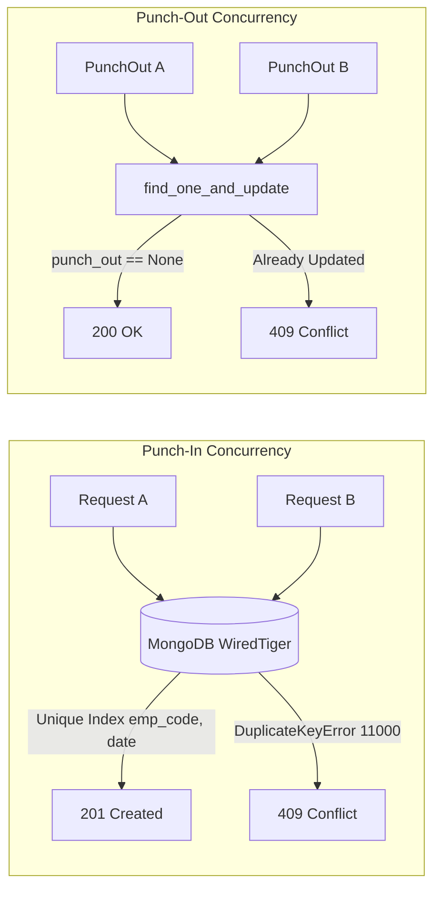

<div align="center">

# ⏱️ Employee Attendance & Analytics API

**High-Performance Attendance Lifecycle, Audit Logging & Analytical Engine**

[](https://www.python.org/)
[](https://fastapi.tiangolo.com/)
[](https://www.mongodb.com/)
[](https://github.com/vamsikiran1234/Employee_Attendence)

<p align="center">
  A production-ready FastAPI backend built for robust employee attendance tracking, concurrency-safe punch events, audit-trailed regularizations, and database-level aggregation analytics.
</p>

---

</div>

## 📌 Overview

This repository implements the complete specification for the **Employee Attendance & Analytics API**. The application manages employee identity, automated punch-in and punch-out calculations across day and night boundaries, immutable historical regularization trails, and MongoDB aggregation pipelines optimized for large-scale performance (~100,000+ records).

### 🚀 Key Technical Highlights
- **100% Contract Compliance**: Strict alignment with `openapi.yaml` (v2.0.0) status codes, models, and constraints.
- **Precision Time Handling**: UTC epoch milliseconds at API boundaries, BSON dates in MongoDB, and IST (`UTC+05:30`) shift and calendar evaluation.
- **Atomic Concurrency Defense**: 
  - Race-safe punch-ins enforced by unique compound indexing (`emp_code`, `date`).
  - Single-winner atomic punch-outs via `find_one_and_update`.
  - Optimistic concurrency control on regularization history logs.
- **Database-Level Analytics**: Aggregation pipelines utilizing `$rank` window functions, `$densify` temporal gap-filling, and cross-collection `$lookup` operations with zero in-memory Python looping.
- **Index-Backed Query Execution**: Verified with `GET /admin/explain/{endpoint}` (`IXSCAN` utilized; zero `COLLSCAN`).

---

## 🛠️ Business Rules Implementation (R1 – R10)

| Rule | Domain | Logic & Behavior |
|:---:|---|---|
| **R1** | **Timezone & Shifts** | Shift schedules and dates evaluated in IST. Instants truncated to whole seconds (`.replace(microsecond=0)`). Overnight shifts (`shift_end <= shift_start`) punching in before `shift_end` map to the previous day's shift. |
| **R2** | **Grace & Late Calculation** | 10-minute grace window. Late minutes trigger only when punch-in is **strictly > 10:00** past `shift_start` (e.g., `09:40:01` $\to$ 10 min; `09:40:00` $\to$ 0 min). Floor minutes calculated from `shift_start`. |
| **R3** | **Overtime** | Measured from `shift_end` to `punch_out`. Counted only if $\ge 30$ minutes (floor minutes); otherwise 0. |
| **R4** | **Work Hours** | `(punch_out - punch_in) in seconds / 3600.0`. Rounded half-up to 2 decimals using `Decimal` arithmetic. |
| **R5** | **Half Day** | Triggered when rounded `work_hours < 4.50`. Accrues 0.5 of a present day. |
| **R6** | **Presence Mapping** | `PRESENT`, `WFH`, and `ON_DUTY` count as present; `ABSENT` and `LEAVE` do not. |
| **R7** | **Working Days** | Monday through Friday calendar days. Mid-month joiners counted from `max(month_start, joined_on)`. `present_days` tracks Mon–Fri records only (weekend logs add to late/overtime totals). |
| **R8** | **Reporting Precision** | Values rounded 2 decimals half-up; percentage rates rounded 4 decimals half-up. |
| **R9** | **Headcount Integrity** | Evaluates employees with `joined_on <= period_end`, including employees with zero attendance logs. |
| **R10** | **Pagination & Bounds** | 1-based indexing (`page >= 1`), default size 20, max size 100. Filter-aware total counts. |

---

## 📡 API Contract & Endpoints

<details open>
<summary><b>1. Core System & Employees</b></summary>

| Method | Endpoint | Description | Status Codes |
|---|---|---|:---:|
| `GET` | `/health` | Active MongoDB readiness probe pinging database cluster | `200`, `503` |
| `POST` | `/employees` | Registers new employee; validates codes (`EMP\d{4,6}`), emails, and shifts | `201`, `409`, `422` |
| `GET` | `/employees` | Paginated listing sorted by `emp_code` ascending with department filtering | `200`, `422` |

</details>

<details open>
<summary><b>2. Attendance Lifecycle & Regularization</b></summary>

| Method | Endpoint | Description | Status Codes |
|---|---|---|:---:|
| `POST` | `/attendance/punch-in` | Creates attendance record for the day (R1, R2); race-safe unique key | `201`, `404`, `409`, `422` |
| `POST` | `/attendance/punch-out` | Closes active record across midnight; computes work hours, OT, half-day | `200`, `404`, `409`, `422` |
| `GET` | `/attendance` | Cursor-based indexed listing by employee, status, and date range | `200`, `422` |
| `PATCH` | `/attendance/{emp_code}/{date}` | Regularizes records; recomputes metrics; appends immutable `history` audit | `200`, `404`, `409`, `422` |

</details>

<details open>
<summary><b>3. Analytical Aggregations & Query Optimization</b></summary>

| Method | Endpoint | Description | Status Codes |
|---|---|---|:---:|
| `GET` | `/analytics/employees/{emp_code}/monthly` | Aggregates working days, presence days, leave, late & overtime stats | `200`, `404`, `422` |
| `GET` | `/analytics/departments/summary` | Cross-collection rollup; department headcount (0-log safe), mean hours | `200`, `422` |
| `GET` | `/analytics/leaderboard/late` | Competition ranking (`$rank`: 1, 2, 2, 4); preserves all ties at limit cutoff | `200`, `422` |
| `GET` | `/analytics/departments/{department}/trend` | Gap-filled 92-day calendar sequence (`$densify`) with 7-day moving average | `200`, `404`, `422` |
| `GET` | `/admin/explain/{endpoint}` | Runs `explain("executionStats")` proving index scans (`IXSCAN`) | `200`, `422` |

</details>

---

## ⚡ Concurrency & Architectural Decisions



- **Race Conditions**: Enforced at the engine level via compound unique index `{ emp_code: 1, date: 1 }` on `attendance_logs`. Duplicate insertions raise `DuplicateKeyError` and return `409 Conflict`.
- **Atomic State Transitions**: Punch-out executes atomically with `{"punch_out": None}`, guaranteeing only one winner under concurrent requests.
- **Audit Immutability**: Manual corrections append `{ at, by, reason, changes }` records with optimistic concurrency control on history length to prevent lost updates.
- **Database Scaling (100k+ Records)**: Index scans backing all list and aggregation stages eliminate full collection scans (`COLLSCAN`).

---

## 💻 Local Setup & Execution

### Prerequisites
- Python 3.11+
- MongoDB 6.0+ (or MongoDB Atlas)

### Installation Steps

1. **Clone the repository:**
   ```bash
   git clone https://github.com/vamsikiran1234/Employee_Attendence.git
   cd Employee_Attendence
   ```

2. **Set up virtual environment:**
   ```bash
   python -m venv .venv
   # Windows PowerShell:
   .venv\Scripts\Activate.ps1
   # Linux / macOS:
   source .venv/bin/activate
   ```

3. **Install dependencies:**
   ```bash
   pip install -r requirements.txt
   ```

4. **Configure Environment Variables:**
   Create a `.env` file in the root directory:
   ```env
   MONGO_URI=mongodb://localhost:27017
   MONGO_DB=attendance_db
   ```
   *(Note: System environment variables always take precedence over `.env`).*

5. **Seed Sample Data (Optional):**
   ```bash
   python sample_seed.py
   ```

6. **Start Application:**
   ```bash
   python -m uvicorn app.main:app --port 8000 --reload
   ```

7. **Interactive API Documentation:**
   Access OpenAPI Swagger UI at: **[http://localhost:8000/docs](http://localhost:8000/docs)**

---

## 🧪 Automated Testing

Execute the test suite to verify all business rules (R1 through R10) and calculations:
```bash
python test_app.py
```

---

## 📁 Repository Structure

```text
├── app/
│   ├── __init__.py
│   └── main.py              # Complete application code (endpoints, models, pipelines)
├── sample_data/
│   ├── employees.json        # Extended JSON sample documents
│   └── attendance_logs.json  # Extended JSON attendance documents
├── DATA_MODEL.md             # MongoDB collection specifications and field types
├── DECISIONS.md              # Architectural design choices and technical justifications
├── REVIEW.md                 # Defect review and audit of starter code
├── openapi.yaml              # OpenAPI v2.0.0 API specification contract
├── requirements.txt          # Python dependencies
├── sample_seed.py            # Database seeder utility
├── test_app.py               # Automated business rule test suite
├── .gitignore                # Git ignore configuration (secrets and local env excluded)
└── README.md                 # Project documentation and execution instructions
```

---

<div align="center">
  <b>Built for HROne Software Engineer Trainee Engineering Assignment</b>
</div>
